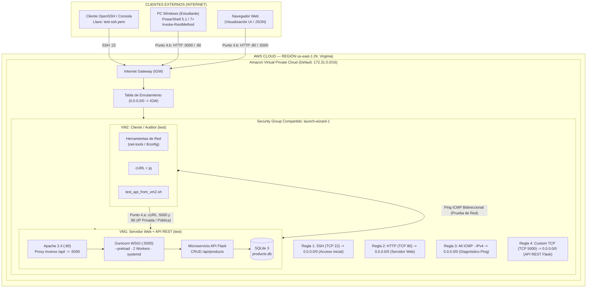

# INFORME TÉCNICO: DESPLIEGUE DE INFRAESTRUCTURA COMO SERVICIO (IaaS) EN AWS EC2, SERVIDOR WEB APACHE Y MICROSERVICIO API RESTFUL CON PERSISTENCIA

**Asignatura:** Ambiente de Desarrollo / Servicios Telemáticos  
**Profesor:** Prof. Oscar Mondragón  
**Estudiante:** Eduard Criollo Yule  
**Código:** 2220335  
**Correo Institucional:** `eduard.criollo@uao.edu.co`  
**Semestre:** 9no Semestre  
**Repositorio:** [Practica_AmbienteDesarrollo](https://github.com/CriolloYule/Practica_AmbienteDesarrollo)  
**Directorio de la Práctica:** `mipracticas/Practica11`

---

## 1. Resumen Ejecutivo y Objetivos

### 1.1 Resumen Ejecutivo

El presente informe técnico documenta el diseño, aprovisionamiento, despliegue, endurecimiento perimetral y auditoría de una topología de **Infraestructura como Servicio (IaaS)** en la nube de **Amazon Web Services (AWS)** bajo el entorno académico **AWS Academy Learner Lab**.

Tomando como documento rector la guía de laboratorio [2024-03 Practica AWS EC2.pdf](file:///d:/Documentos/Practica_AmbienteDesarrollo/mipracticas/Practica11/2024-03%20Practica%20AWS%20EC2.pdf) y su referencia audiovisual obligatoria ([Demostración oficial en YouTube: 4MeU2wo7EmA](https://www.youtube.com/watch?v=4MeU2wo7EmA)), la práctica articula la experiencia de laboratorio en dos fases complementarias:

1. **Fase 1: Réplica Fiel del Video Guía (Sección 3 del Documento Rector):**
   * Acceso al sistema LMS de AWS Academy, lanzamiento del entorno **Learner Lab**, gestión del temporizador de sesión de **4 horas** y control de presupuesto asignado (~$100 USD).
   * Lanzamiento simultáneo en un solo paso (**`Number of instances = 2`**) de dos máquinas virtuales basadas en **Ubuntu Server 22.04 LTS (HVM)** tipo **`t2.micro`** dentro de la VPC por defecto en la región `us-east-1` (N. Virginia), empleando un único par de claves criptográficas (`test-ssh.pem`) y un **Security Group compartido** (`launch-wizard-1`) con acceso inicial restringido a SSH.
   * Conexión por dos vías: consola web en navegador (**EC2 Instance Connect**) y cliente SSH nativo con permisos restringidos (`chmod 400` en Linux / `icacls` en Windows).
   * Instalación de herramientas de red (`net-tools` para `ifconfig`) y despliegue manual del servidor web **Apache 2.4** en la primera máquina virtual.
   * **Demostración didáctica de fallos y resolución por firewall perimetral:**
     * *Prueba HTTP:* Demostración de que la petición web hacia la IP privada y pública falla por bloqueo perimetral $\rightarrow$ Apertura de la regla de entrada para **HTTP (Puerto TCP 80, 0.0.0.0/0)** $\rightarrow$ Comprobación de respuesta exitosa de la página de Apache.
     * *Prueba ICMP:* Demostración de que el comando `ping` entre instancias en ambos sentidos falla $\rightarrow$ Apertura de la regla **All ICMP - IPv4 (0.0.0.0/0)** $\rightarrow$ Comprobación de latencia bidireccional inmediata (< 0.5 ms).
2. **Fase 2: Resolución Integral del Ejercicio (Punto 4 del Documento Rector):**
   * Despliegue de un microservicio **API RESTful en Python Flask + Gunicorn** con persistencia relacional en SQLite (portado y estandarizado a partir del catálogo de productos de la Práctica 9) en la primera máquina virtual, integrado con Apache mediante una directiva de proxy inverso en `/api/`.
   * **Punto 4.a (Consumo Inter-Máquina):** Apertura controlada del puerto TCP 5000 y consumo/auditoría del ciclo de vida CRUD completo desde la segunda máquina virtual hacia la IP privada y pública de la primera máquina mediante `curl` automatizado.
   * **Punto 4.b (Consumo desde Dispositivo Externo):** Consumo y validación de la API REST desde el equipo anfitrión personal (PC Windows vía PowerShell `Invoke-RestMethod` y navegador web) utilizando la **dirección IP pública real** asignada por AWS.

---

### 1.2 Objetivos del Laboratorio

1. **Comprender la Operación de IaaS en la Nube Pública:** Analizar los principios de computación bajo demanda, elasticidad y autoservicio estandarizados en NIST SP 800-145 operando sobre la infraestructura global de AWS.
2. **Dominar el Aprovisionamiento y Ciclo de Vida en Amazon EC2:** Configurar instancias virtuales elásticas, seleccionar AMIs certificadas, gestionar el ciclo de estados (*Running*, *Stopped*, *Terminated*) y entender la transitoriedad de las direcciones IPv4 públicas.
3. **Comprender el Modelo de Seguridad Perimetral Stateful (Security Groups):** Analizar el filtrado de paquetes a nivel de hipervisor, contrastando su naturaleza con estado frente a las listas de control de acceso a la red (*stateless* NACLs), experimentando en tiempo real el efecto de bloqueo y admisión de reglas.
4. **Implementar Microservicios Web Escalables y Endurecidos:** Desplegar servidores de aplicaciones WSGI (**Gunicorn**) supervisados por **systemd** bajo el principio de mínimo privilegio, coordinados tras un proxy inverso en **Apache 2.4**.
5. **Gestionar Eficientemente los Recursos en la Nube (FinOps Básico):** Administrar créditos de laboratorio, comprender los cobros asociados a direcciones IPv4 públicas desde 2024 y aplicar buenas prácticas de apagado y desaprovisionamiento.

---

## 2. Marco Teórico y Operación en AWS Academy

### 2.1 Computación en la Nube (NIST SP 800-145) y Modelo de Responsabilidad Compartida

De acuerdo con el estándar internacional **NIST SP 800-145**, la computación en la nube se define a través de cinco características esenciales: *Autoservicio bajo demanda*, *Acceso amplio a la red*, *Agrupación de recursos multi-inquilino*, *Elasticidad rápida* y *Servicio medido*.

En el modelo de **Infraestructura como Servicio (IaaS)** adoptado mediante **Amazon EC2**, la responsabilidad operativa se divide de acuerdo con el **Modelo de Responsabilidad Compartida de AWS**:

```
+-----------------------------------------------------------------------------------------+
|                                    RESPONSABILIDAD DEL CLIENTE                          |
|                                    ("SEGURIDAD EN LA NUBE")                             |
|  - Gestión de Identidad y Accesos (par de claves SSH test-ssh.pem, permisos icacls/400) |
|  - Configuración del Sistema Operativo Huésped (Ubuntu 22.04 LTS, parches, net-tools)   |
|  - Firewall Perimetral de la Instancia (Security Groups: puertos 22, 80, 5000, ICMP)    |
|  - Aplicación y Servicios (Apache 2.4, Gunicorn, Flask, dependencias de Python)         |
|  - Gestión de Costos y Ciclo de Vida (Apagado / Terminación de instancias en desuso)    |
+-----------------------------------------------------------------------------------------+
|                                     RESPONSABILIDAD DE AWS                              |
|                                    ("SEGURIDAD DE LA NUBE")                             |
|  - Infraestructura Física de Cómputo, Almacenamiento y Centros de Datos (AZs us-east-1) |
|  - Hipervisor de Virtualización de Hardware (AWS Nitro System / KVM)                    |
|  - Infraestructura de Red de la VPC y Enlaces Físicos de Internet Gateway               |
+-----------------------------------------------------------------------------------------+
```

---

### 2.2 Entorno de Operación: AWS Academy Learner Lab

El **Learner Lab** es una plataforma educativa de AWS que provee acceso a un subconjunto regulado de servicios de nube con características operacionales específicas:

* **Acceso y Navegación LMS:** El acceso se realiza desde la plataforma educativa de la asignatura ingresando al módulo **AWS Academy Learner Lab** $\rightarrow$ **Launch AWS Academy Learner Lab**.
* **Temporizador de Sesión de 4 Horas:** Al pulsar el botón **"Start Lab"**, el entorno inicia el aprovisionamiento de las credenciales de sesión temporal de AWS (AWS STS). Cuando el indicador circular cambia de color rojo a **verde**, el botón **"AWS"** se activa, permitiendo abrir la Consola de Administración de AWS en una nueva pestaña. Cada sesión activa tiene una vigencia máxima de **4 horas**. Si el tiempo expira mientras se está trabajando, el laboratorio se detiene automáticamente; no obstante, el estudiante puede pulsar **"Start Lab"** nuevamente para reanudar la sesión sin perder las instancias ni los datos guardados en sus volúmenes EBS.
* **Presupuesto Asignado:** El laboratorio cuenta con un presupuesto fijo asignado por estudiante (aproximadamente **$100 USD**) para toda la duración del curso. Es fundamental apagar o terminar instancias que no se estén utilizando para evitar agotar dicho presupuesto.
* **Diferencia entre Detener, Terminar y Reset:**
  * **Stop (Detener):** Libera los recursos de CPU y memoria física en el hipervisor de AWS. La instancia pasa al estado *Stopped*. No se factura por cómputo, pero se mantiene un cobro mínimo por el almacenamiento persistente en el volumen EBS asociado. **La dirección IPv4 pública dinámica se libera**.
  * **Terminate (Terminar):** Elimina permanentemente la máquina virtual y destruye su volumen raíz EBS asociado. La acción es irreversible.
  * **End Lab (Finalizar Laboratorio en LMS):** Detiene la sesión de 4 horas y suspende las máquinas virtuales automáticamente, conservando su configuración y almacenamiento en disco para la próxima sesión.
  * **Reset (Restablecer Laboratorio en LMS):** Destruye de forma absoluta todos los recursos creados en la cuenta de AWS (instancias EC2, volúmenes, Security Groups, llaves) y restablece el ambiente a su estado virgen inicial.
* **Política de Costos para Direcciones IPv4 Públicas (Vigente desde Febrero de 2024):** AWS cobra **$0.005 USD por hora** por cada dirección IPv4 pública activa asignada a una instancia en ejecución, reforzando la necesidad de gestionar conscientemente el ciclo de vida de los servidores.

---

### 2.3 Topología y Arquitectura del Sistema (Security Group Compartido)

Siguiendo el diseño del video oficial, ambas instancias se instancian bajo un **Security Group común** (`launch-wizard-1`), el cual actúa como firewall virtual a nivel de Interfaz de Red Elástica (ENI):



---

### 2.4 Mecanismos Perimetrales: Security Groups (Stateful) vs. Network ACLs (Stateless)

* **Security Groups:** Operan a nivel de instancia/interfaz de red. Son de naturaleza **Stateful (con estado)**: si una regla de entrada (*Inbound rule*) autoriza el tráfico (por ejemplo, el puerto TCP 80), el paquete de respuesta de retorno es autorizado automáticamente hacia el cliente por cualquier puerto efímero sin requerir una regla de salida explícita.
* **Network ACLs:** Operan a nivel de subred y son **Stateless (sin estado)**: requieren autorizar explícitamente tanto el tráfico entrante como el rango completo de puertos efímeros de salida (1024-65535).
* **Demostración Práctica del Video:** En la sección 4 de este informe se comprueba empíricamente cómo la ausencia de una regla en el Security Group descarta de inmediato los paquetes SYN a nivel de hipervisor, sin permitir que la petición llegue al sistema operativo de la máquina virtual.

---

### 2.5 Criptografía Asimétrica y Acceso por SSH

Para acceder a las instancias de Linux en EC2, AWS implementa criptografía de clave pública:
1. **Clave Pública:** AWS inyecta la clave pública seleccionada durante el lanzamiento (`test-ssh`) dentro del archivo `/home/ubuntu/.ssh/authorized_keys` de la instancia mediante `cloud-init`.
2. **Clave Privada (`test-ssh.pem`):** El usuario la descarga una única vez a su máquina local.
3. **Manejo Estricto de Permisos:** El cliente OpenSSH rechaza de forma tajante claves privadas que tengan permisos abiertos para otros usuarios (*UNPROTECTED PRIVATE KEY FILE*).
   * En Linux/macOS se utiliza: `chmod 400 test-ssh.pem`
   * En Windows PowerShell se utiliza la utilidad de listas de control de acceso:
     ```powershell
     icacls.exe "test-ssh.pem" /inheritance:r
     icacls.exe "test-ssh.pem" /grant:r "$($env:USERNAME):(R)"
     ```
4. **EC2 Instance Connect:** Es un mecanismo alternativo que permite conectarse a la terminal directamente desde el navegador web de la consola de AWS. Utiliza una API de AWS para inyectar una clave pública temporal (vigente por 60 segundos) en los metadatos de la instancia. **Requiere que el puerto TCP 22 esté abierto hacia Internet (`0.0.0.0/0`) o hacia el bloque CIDR específico del servicio de Instance Connect en la región `us-east-1`**.

---

## 3. Exposición y Justificación Técnica de Archivos

```
                                 ESTRUCTURA DE ARCHIVOS DE LA PRÁCTICA 11
+-----------------------------------------------------------------------------------------------------------------+
| mipracticas/Practica11/                                                                                         |
| ├── 2024-03 Practica AWS EC2.pdf       -> Documento rector oficial de la práctica                               |
| ├── README.md                          -> Informe técnico formal, marco teórico, arquitectura y evidencias      |
| ├── SUSTENTACION.md                    -> Guía oral en pantalla con alternancia estricta y banco de preguntas   |
| ├── .gitignore                         -> Exclusión estricta de *.pem, *.ppk, .env, *.db y credenciales         |
| ├── .gitattributes                     -> Normalización forzada eol=lf para compatibilidad Linux/Windows        |
| ├── .env.example                       -> Parámetros de entorno de sesión parametrizables sin secretos         |
| ├── api/                               -> Microservicio API RESTful en Python Flask                             |
| │   ├── app.py                         -> Factoría create_app(), integración con IMDSv2 y manejadores JSON     |
| │   ├── config.py                      -> Configuración 12-Factor App (SQLite en disco / TestConfig en memoria)  |
| │   ├── extensions.py                  -> Instancia global desacoplada de db = SQLAlchemy()                     |
| │   ├── wsgi.py                        -> Punto de entrada estándar PEP 3333 para Gunicorn                      |
| │   ├── requirements.txt               -> Dependencias fijadas (Flask 3.0.3, Gunicorn 22.0.0, SQLAlchemy 3.1.1)|
| │   ├── requirements-dev.txt           -> Dependencias de testing (pytest 8.2.2)                                |
| │   ├── products/                                                                                               |
| │   │   ├── models/product_model.py    -> Entidad Products (id, name, description, price, stock)                |
| │   │   └── controllers/product_controller.py -> Blueprint REST con validaciones CRUD completas y db.get_or_404 |
| │   └── tests/test_products_api.py     -> Suite de pruebas automatizadas (incluye prueba de idempotencia de seed)|
| ├── provision/                         -> Aprovisionamiento y configuración de servidores                       |
| │   ├── install_apache_and_api.sh      -> Instalador y configurador de VM1 (idempotente, < 60 segundos)         |
| │   ├── install_client_tools.sh        -> Instalador de herramientas en VM2 (net-tools, curl, jq, scripts)      |
| │   ├── practica11-api.service         -> Unidad systemd con --preload y directivas de endurecimiento           |
| │   ├── 000-default.conf               -> VirtualHost Apache con ProxyPass inverso /api/ -> :5000               |
| │   └── index.html                     -> Landing Glassmorphism interactiva con metadatos IMDSv2                |
| ├── scripts/                           -> Auditoría automatizada de evaluación                                  |
| │   ├── test_api_from_vm2.sh           -> [PUNTO 4.a] Suite cURL ejecutada desde VM2                            |
| │   └── test_api_from_host.ps1         -> [PUNTO 4.b] Suite PowerShell ejecutada desde PC Anfitrión Windows      |
| └── images/                                                                                                     |
|     └── .gitkeep                       -> Directorio reservado para capturas de pantalla reales del estudiante   |
+-----------------------------------------------------------------------------------------------------------------+
```

---

### 3.1 Exclusión de Secretos en Git: `.gitignore`

* **Ruta en el Repositorio:** [mipracticas/Practica11/.gitignore](file:///d:/Documentos/Practica_AmbienteDesarrollo/mipracticas/Practica11/.gitignore)

```gitignore
# --- Credenciales AWS / SSH (NUNCA versionar) ---
*.pem
*.ppk
*.key
id_rsa*
id_ed25519*
.aws/
credentials
*.csv

# --- Variables de entorno y secretos ---
.env
.env.*
!.env.example

# --- Python ---
__pycache__/
*.py[cod]
*$py.class
venv/
.venv/
env/
.pytest_cache/

# --- Datos locales y logs ---
*.db
*.sqlite3
*.log
.vagrant/
```

#### Justificación Técnica:
1. **Seguridad contra Fugas de Credenciales (OWASP A01 / A07):** La presencia de llaves privadas SSH (`*.pem`) o credenciales IAM en repositorios Git representa un riesgo de compromiso inmediato por parte de escáneres de seguridad públicos.
2. **Higiene del Repositorio:** Evita el seguimiento accidental de bases de datos locales (`*.db`) o archivos de log volátiles generados durante las pruebas.

---

### 3.2 Unidad de Servicio Endurecida en systemd: `practica11-api.service`

* **Ruta en el Repositorio:** [mipracticas/Practica11/provision/practica11-api.service](file:///d:/Documentos/Practica_AmbienteDesarrollo/mipracticas/Practica11/provision/practica11-api.service)

```ini
[Unit]
Description=Practica 11 - Microservicio API REST Flask (Gunicorn)
After=network-online.target
Wants=network-online.target

[Service]
Type=simple
User=practica11
Group=practica11
WorkingDirectory=/opt/practica11/api
Environment="DATABASE_URL=sqlite:////var/lib/practica11/products.db"
Environment="PYTHONUNBUFFERED=1"
# Por qué --preload: Carga la aplicación en el proceso maestro antes de crear los workers,
# garantizando que la inicialización de la base de datos y los datos semilla se ejecuten
# una sola vez, eliminando condiciones de carrera entre workers sobre SQLite.
ExecStart=/opt/practica11/venv/bin/gunicorn --preload --workers 2 --bind 0.0.0.0:5000 --timeout 30 --access-logfile - --error-logfile - wsgi:app
Restart=always
RestartSec=2

# Directivas de endurecimiento de seguridad (OWASP A05 - Security Misconfiguration)
NoNewPrivileges=true
ProtectSystem=full
ProtectHome=true
PrivateTmp=true
ReadWritePaths=/var/lib/practica11

[Install]
WantedBy=multi-user.target
```

#### Justificación Técnica:
1. **Eliminación de Condiciones de Carrera con `--preload`:** Al emplear Gunicorn con múltiples procesos worker sobre una base de datos embebida SQLite, `--preload` asegura que el proceso maestro ejecute `db.create_all()` y el poblado semilla de datos de forma atómica antes de invocar `fork()`, previniendo errores de concurrencia y registros duplicados.
2. **Sandboxing de Sistema de Archivos:** Las directivas `ProtectSystem=full` y `ProtectHome=true` impiden que el proceso del microservicio modifique directorios del sistema como `/etc`, `/usr` o `/root`. La directiva `ReadWritePaths` delimita la escritura exclusivamente a la ruta donde reside la base de datos (`/var/lib/practica11`).

---

### 3.3 VirtualHost con Proxy Inverso en Apache: `000-default.conf`

* **Ruta en el Repositorio:** [mipracticas/Practica11/provision/000-default.conf](file:///d:/Documentos/Practica_AmbienteDesarrollo/mipracticas/Practica11/provision/000-default.conf)

```apache
<VirtualHost *:80>
    ServerAdmin webmaster@localhost
    DocumentRoot /var/www/html

    # Configuración de Proxy Inverso para el Microservicio Flask en Gunicorn
    # Permite consumir el API en el puerto 80 estándar vía http://<IP>/api/products
    ProxyPreserveHost On
    ProxyPass /api/ http://127.0.0.1:5000/api/
    ProxyPassReverse /api/ http://127.0.0.1:5000/api/

    # Cabeceras de seguridad para protección básica
    Header always set X-Content-Type-Options "nosniff"
    Header always set X-Frame-Options "SAMEORIGIN"

    ErrorLog ${APACHE_LOG_DIR}/error.log
    CustomLog ${APACHE_LOG_DIR}/access.log combined
</VirtualHost>
```

#### Justificación Técnica:
1. **Unificación de Puertos:** Permite servir la interfaz web en la raíz `/` y redirigir las peticiones bajo `/api/` hacia el microservicio en el puerto interno 5000, permitiendo consumir la API en redes corporativas donde el puerto 5000 suele estar bloqueado por firewall.
2. **Seguridad HTTP:** Inyecta cabeceras de protección contra sniffing de tipos MIME (`nosniff`) y ataques de clickjacking (`SAMEORIGIN`).

---

## 4. Desarrollo Paso a Paso: Réplica del Video y Ejercicio

### 4.1 Paso 1: Ingreso a AWS Academy Learner Lab
1. Ingresar al LMS institucional de AWS Academy y entrar al curso de la asignatura.
2. Dirigirse a la sección **Módulos** $\rightarrow$ **AWS Academy Learner Lab**.
3. Hacer clic en **"Start Lab"**. El círculo de estado pasará de rojo a amarillo (preparando) y finalmente a **verde**.
4. Una vez en verde, hacer clic en el texto **"AWS"** (al lado del círculo verde) para abrir la Consola de Administración de AWS en una nueva pestaña.
5. Observar en la esquina superior derecha la región activa: **us-east-1 (N. Virginia)**.

---

### 4.2 Paso 2: Lanzamiento de 2 Máquinas Virtuales en un Solo Paso
Siguiendo exactamente el procedimiento demostrado en el video:
1. En la consola de AWS, buscar y seleccionar el servicio **EC2**.
2. Hacer clic en el botón naranja **"Launch instances"**.
3. **Nombre de la instancia:** Indicar `test` (AWS asignará este nombre a ambas máquinas).
4. **Imagen del Sistema Operativo (AMI):** Seleccionar **Ubuntu** $\rightarrow$ `Ubuntu Server 22.04 LTS (HVM), SSD Volume Type` (Arquitectura de 64 bits x86).
5. **Tipo de instancia:** Seleccionar `t2.micro` (1 vCPU, 1 GiB de memoria).
6. **Par de claves (Key pair):**
   * Hacer clic en **"Create new key pair"**.
   * Nombre de la clave: `test-ssh`.
   * Tipo de par de claves: `RSA`.
   * Formato de archivo de clave privada: `.pem`.
   * Hacer clic en **"Create key pair"**. El navegador descargará inmediatamente el archivo `test-ssh.pem` a la carpeta local de *Descargas* (*Downloads*).
7. **Configuración de red (Network settings):**
   * Dejar la VPC por defecto seleccionada con asignación automática de IP pública (*Auto-assign public IP: Enable*).
   * En **Firewall (security groups)**: Seleccionar **Create security group**. AWS creará el grupo por defecto `launch-wizard-1`.
   * Por defecto, únicamente estará habilitada la casilla:
     * *Allow SSH traffic from anywhere (0.0.0.0/0)*.
     * **No marcar** las casillas de HTTP ni HTTPS en este punto (para reproducir la demostración didáctica de fallo).
8. **Almacenamiento (Configure storage):** Mantener el disco por defecto de 8 GiB gp2/gp3.
9. **Número de instancias (Summary en el panel derecho):**
   * En el campo **Number of instances**, cambiar `1` por **`2`**.
10. Hacer clic en **"Launch instance"**.
11. Ir al panel **Instances** y observar cómo ambas máquinas pasan al estado *Running*. Para identificarlas con facilidad en la sustentación, se recomienda renombrar una como `test-vm1-servidor` y la otra como `test-vm2-cliente`.

---

### 4.3 Paso 3: Conexión a las Máquinas Virtuales (Instance Connect y SSH)

#### Opción A: Conexión mediante EC2 Instance Connect (Demostrada en el video)
1. En el listado de instancias de la consola de AWS, seleccionar `test-vm1-servidor` y pulsar el botón **"Connect"**.
2. En la pestaña **EC2 Instance Connect**, verificar que el nombre de usuario sea `ubuntu` y hacer clic en **"Connect"**.
3. Se abrirá una terminal web interactiva en una nueva pestaña del navegador conectada directamente a la consola de Ubuntu.

#### Opción B: Conexión mediante Cliente SSH Local (Demostrada en el video)
1. Abrir una consola (Terminal en Linux/macOS o PowerShell en Windows).
2. Ubicarse en el directorio donde se descargó la llave (`Downloads`):
   ```powershell
   cd $HOME\Downloads
   ```
3. Aplicar permisos restringidos sobre la clave:
   * En Windows PowerShell:
     ```powershell
     icacls.exe test-ssh.pem /inheritance:r
     icacls.exe test-ssh.pem /grant:r "$($env:USERNAME):(R)"
     ```
   * En Linux/macOS:
     ```bash
     chmod 400 test-ssh.pem
     ```
4. Conectarse a cada máquina usando su DNS público o su IP pública:
   * **Terminal para VM1:**
     ```bash
     ssh -i test-ssh.pem ubuntu@52.91.99.132
     ```
   * **Terminal para VM2 (abrir otra ventana):**
     ```bash
     ssh -i test-ssh.pem ubuntu@54.221.25.113
     ```

---

### 4.4 Paso 4: Diagnóstico Inicial de Red (`net-tools` e `ifconfig`)
Tal como se realiza en el video, se instala `net-tools` en ambas máquinas para visualizar las direcciones IP privadas asignadas por el DHCP de la VPC:

* En VM1:
  ```bash
  sudo apt-get update && sudo apt-get install -y net-tools
  ifconfig
  ```
* En VM2:
  ```bash
  sudo apt-get update && sudo apt-get install -y net-tools
  ifconfig
  ```
*(Anotar la IP privada de cada máquina, por ejemplo `172.31.X.X` en la interfaz `eth0` o `ens5`)*.

---

### 4.5 Paso 5: Instalación Manual de Apache2 en VM1
En la terminal de **VM1**:
```bash
sudo apt-get install -y apache2
```
Comprobar localmente que Apache está escuchando y respondiendo en el puerto 80 local:
```bash
curl localhost
```
*Resultado:* La consola imprime el código HTML de la página de bienvenida por defecto de Apache: `<!DOCTYPE html PUBLIC ... <h1>It works!</h1>`.

---

### 4.6 Paso 6: Prueba de Fuego 1 (HTTP) — Fallo y Apertura de Regla en Security Group

#### 1. Demostración del Fallo:
* Desde la terminal de **VM2**, intentar consultar el servidor web de VM1 usando su IP privada:
  ```bash
  curl --max-time 5 http://172.31.16.58
  ```
  *Resultado:* El comando queda bloqueado y finaliza con `Connection timed out` tras 5 segundos.
* Desde el navegador del PC anfitrión (Windows), intentar acceder a la IP pública de VM1:
  `http://52.91.99.132`
  *Resultado:* El navegador muestra *"No se puede acceder a este sitio"* / *"Tiempo de espera agotado"*.

*Explicación:* El Security Group `launch-wizard-1` solo contiene la regla para el puerto 22 (SSH). Todo el tráfico entrante dirigido al puerto 80 es descartado por el hipervisor de AWS antes de tocar el sistema operativo.

#### 2. Apertura de la Regla en la Consola de AWS:
1. En la consola de AWS EC2, ir a **Network & Security** $\rightarrow$ **Security Groups**.
2. Seleccionar el grupo `launch-wizard-1` asociado a las instancias.
3. En la pestaña inferior **Inbound rules**, hacer clic en **"Edit inbound rules"**.
4. Pulsar **"Add rule"**:
   * **Type:** `HTTP`
   * **Port range:** `80`
   * **Source:** `Anywhere-IPv4` (`0.0.0.0/0`)
5. Hacer clic en **"Save rules"**.

#### 3. Comprobación del Éxito:
* Repetir desde **VM2**:
  ```bash
  curl http://172.31.16.58
  ```
  *Resultado:* Responde inmediatamente el HTML `<h1>It works!</h1>` de Apache.
* Refrescar en el navegador del PC anfitrión `http://52.91.99.132`.
  *Resultado:* Carga exitosamente la página oficial de bienvenida de Apache Ubuntu.

---

### 4.7 Paso 7: Prueba de Fuego 2 (ICMP Ping) — Fallo y Apertura de Regla Bidireccional

#### 1. Demostración del Fallo:
* Desde **VM1** hacer ping a VM2:
  ```bash
  ping -c 3 -W 2 172.31.23.119
  ```
* Desde **VM2** hacer ping a VM1:
  ```bash
  ping -c 3 -W 2 172.31.16.58
  ```
  *Resultado:* En ambos sentidos se reporta `100% packet loss` (paquetes perdidos). El protocolo ICMP no utiliza puertos TCP/UDP, por lo que las reglas anteriores no lo cubren.

#### 2. Apertura de la Regla en el Security Group:
1. En la consola de AWS $\rightarrow$ Security Groups $\rightarrow$ `launch-wizard-1` $\rightarrow$ **Edit inbound rules**.
2. Pulsar **"Add rule"**:
   * **Type:** `All ICMP - IPv4`
   * **Port range:** Automáticamente deshabilitado (no aplica)
   * **Source:** `Anywhere-IPv4` (`0.0.0.0/0`)
3. Hacer clic en **"Save rules"**.

#### 3. Comprobación del Éxito:
* Repetir el ping en ambos sentidos:
  ```bash
  ping -c 3 172.31.23.119   # Desde VM1 hacia VM2
  ping -c 3 172.31.16.58    # Desde VM2 hacia VM1
  ```
  *Resultado:* Respuestas inmediatas con `0% packet loss` y tiempos de respuesta de entre 0.2 ms y 0.5 ms.

---

### 4.8 Paso 8: Despliegue del API REST Flask en VM1 (Ejercicio de la Guía)
Una vez validada la sección guiada del video, procedemos a cumplir el requerimiento del **Ejercicio (Punto 4 de la guía)**: instalar un API REST funcional en una máquina virtual y probarlo desde la otra y desde un dispositivo externo.

#### 1. Apertura de Regla para el Puerto 5000 en el Security Group:
En `launch-wizard-1` $\rightarrow$ **Edit inbound rules** $\rightarrow$ **Add rule**:
* **Type:** `Custom TCP`
* **Port range:** `5000`
* **Source:** `Anywhere-IPv4` (`0.0.0.0/0`)
* Guardar reglas (*Save rules*).

#### 2. Aprovisionamiento Desatendido del API en VM1:
En la terminal SSH de **VM1**, ejecutar la descarga e instalación desatendida del microservicio:
```bash
TMP=$(mktemp -d) && git clone --depth 1 --filter=blob:none --sparse https://github.com/EduardCY/Practica_AmbienteDesarrollo.git "$TMP" && git -C "$TMP" sparse-checkout set mipracticas/Practica11 && sudo bash "$TMP/mipracticas/Practica11/provision/install_apache_and_api.sh"
```
*(El script instala dependencias de Python, crea el usuario de servicio `practica11`, activa el servicio systemd con Gunicorn `--preload` en el puerto 5000, configura el proxy inverso de Apache y realiza el health-check en menos de 45 segundos)*.

Verificar en VM1:
```bash
systemctl is-active practica11-api.service apache2
sudo ss -tulpn | grep -E "apache2|gunicorn"
curl -s http://127.0.0.1:5000/api/health | jq .
```

---

### 4.9 Paso 9: Resolución del Punto 4.a — Consumo desde VM2 hacia VM1
En la terminal de **VM2**, descargar los scripts de auditoría y ejecutar la suite automatizada:

```bash
TMP=$(mktemp -d) && git clone --depth 1 --filter=blob:none --sparse https://github.com/EduardCY/Practica_AmbienteDesarrollo.git "$TMP" && git -C "$TMP" sparse-checkout set mipracticas/Practica11 && cp -r "$TMP/mipracticas/Practica11/scripts" ~/ && chmod +x ~/scripts/*.sh
```

Ejecutar auditoría hacia el puerto nativo 5000 usando la **IP privada** de VM1:
```bash
~/scripts/test_api_from_vm2.sh 172.31.16.58 5000
```

Ejecutar auditoría hacia el puerto nativo 5000 usando la **IP pública** de VM1:
```bash
~/scripts/test_api_from_vm2.sh 52.91.99.132 5000
```

Ejecutar auditoría a través del **proxy inverso de Apache (Puerto 80)**:
```bash
~/scripts/test_api_from_vm2.sh 172.31.16.58 80
```

*Comportamiento verificado:* El script ejecuta secuencialmente:
1. Health-check de estado (`GET /api/health` $\rightarrow$ 200 OK).
2. Consulta de catálogo inicial (`GET /api/products` $\rightarrow$ 200 OK).
3. Registro de un nuevo producto vía `POST /api/products` capturando el `id` dinámico asignado ($\rightarrow$ 201 Created).
4. Verificación de persistencia consultando el producto por su ID ($\rightarrow$ 200 OK).
5. Modificación de atributos vía `PUT /api/products/<id>` ($\rightarrow$ 200 OK).
6. Eliminación del producto vía `DELETE /api/products/<id>` ($\rightarrow$ 200 OK).
7. Comprobación de integridad confirmando que la consulta posterior retorne `404 Not Found`.

---

### 4.10 Paso 10: Resolución del Punto 4.b — Consumo desde Dispositivo Externo (Host Windows)
Desde la máquina anfitriona Windows (fuera de la red de AWS):

#### 1. Verificación del Socket TCP y Curl Nativo:
```powershell
Test-NetConnection -ComputerName "52.91.99.132" -Port 5000
curl.exe -s "http://52.91.99.132:5000/api/health"
```

#### 2. Ejecución de la Suite Automatizada en PowerShell:
```powershell
Set-Location "d:\Documentos\Practica_AmbienteDesarrollo\mipracticas\Practica11"
.\scripts\test_api_from_host.ps1 -PublicIp "52.91.99.132" -Port 5000
```

#### 3. Validación Interactiva en Navegador Web:
* Abrir `http://52.91.99.132/`: Carga el portal Glassmorphism con los metadatos de la instancia inyectados por IMDSv2. Al hacer clic en **"Consultar Catálogo"**, se ejecuta una llamada AJAX interna que lista los productos en tiempo real.
* Abrir `http://52.91.99.132:5000/api/products`: Entrega directamente el JSON estructurado del catálogo.
* *(Opcional)* Abrir la URL desde el navegador de un teléfono móvil conectado a datos móviles para evidenciar consumo desde cualquier red externa.

---

### 4.11 Paso 11: Ciclo de Vida y Limpieza en AWS Academy
Siguiendo las recomendaciones del video al terminar la sesión:
1. **Detener instancias para pausar cobros:** Seleccionar ambas instancias en la consola $\rightarrow$ **Instance state** $\rightarrow$ **Stop instance**.
2. **Finalizar sesión en LMS:** Al terminar la jornada de estudio, volver a la pestaña de AWS Academy Learner Lab y pulsar **"End Lab"**.
3. **Terminación definitiva (cuando la práctica esté evaluada):** **Instance state** $\rightarrow$ **Terminate instance** para eliminar cómputo y volúmenes EBS asociados.

---

## 5. Tabla de Evidencias Reales de Ejecución

Siguiendo la política estricta de **cero evidencias sintéticas**, las capturas de pantalla deben ser tomadas directamente por el estudiante durante la ejecución real en AWS Academy y almacenadas en el directorio `images/`:

| Archivo de Imagen | Descripción de la Evidencia Requerida | Estado |
| :--- | :--- | :--- |
| `images/01_aws_lms_start_lab.png` | Pantalla de AWS Academy Learner Lab mostrando el indicador en verde, temporizador activo de 4h y presupuesto disponible. | Pendiente de captura real |
| `images/02_ec2_instances_running.png` | Consola de EC2 mostrando las 2 instancias creadas en un solo paso (`count=2`), en estado *Running* y con IPs visibles. | Pendiente de captura real |
| `images/03_ssh_connections.png` | Dos terminales locales conectadas por SSH a VM1 y VM2 respectivamente tras configurar permisos `chmod 400` / `icacls`. | Pendiente de captura real |
| `images/04_curl_falla_sin_regla_http.png` | Terminal de VM2 mostrando el fallo `Connection timed out` al intentar acceder por HTTP a VM1 sin la regla en el Security Group. | Pendiente de captura real |
| `images/05_regla_http_agregada_exito.png` | Consola de AWS con la regla HTTP agregada y terminal de VM2 mostrando la respuesta inmediata de Apache. | Pendiente de captura real |
| `images/06_ping_falla_y_regla_icmp.png` | Consola mostrando fallo de ping en ambos sentidos y posterior éxito tras agregar la regla All ICMP - IPv4. | Pendiente de captura real |
| `images/07_punto_4a_vm2_audit_curl.png` | Ejecución exitosa de `test_api_from_vm2.sh` desde VM2 hacia VM1 con todas las aserciones en PASS. | Pendiente de captura real |
| `images/08_punto_4b_host_powershell.png` | Ejecución de `test_api_from_host.ps1` desde Windows PowerShell mostrando la validación CRUD completa contra la IP pública. | Pendiente de captura real |
| `images/09_punto_4b_browser_landing.png` | Navegador web en Windows visualizando la landing page interactiva en `http://52.91.99.132/` con datos de IMDSv2. | Pendiente de captura real |

---

## 6. Análisis de Seguridad y Auditoría Red Team

1. **Riesgo Aceptado del Laboratorio:** En la guía audiovisual, las reglas para SSH (22), HTTP (80) e ICMP se configuran con origen `0.0.0.0/0` (Anywhere-IPv4) con propósitos de simplicidad didáctica y para permitir que el servicio web de **EC2 Instance Connect** funcione sin configurar rangos de IP específicos.
2. **Mitigación Empresarial Recomendada:** En un entorno productivo real:
   * El puerto TCP 22 debe restringirse estrictamente a la IP pública del administrador (`My IP`) o al prefijo de red de Instance Connect para la región (`com.amazonaws.us-east-1.ec2-instance-connect`).
   * El tráfico ICMP debe restringirse exclusivamente al bloque CIDR de la VPC privada (`172.31.0.0/16`) para evitar que atacantes externos realicen reconocimiento de red mediante escaneo de ping.
3. **Aislamiento de Aplicaciones:** El microservicio Flask se protege en el sistema operativo mediante el usuario de sistema `practica11` (sin shell interactivo `/usr/sbin/nologin`) y directivas de sandboxing en systemd (`ProtectSystem=full`, `ProtectHome=true`, `NoNewPrivileges=true`).

---

## 7. Referencias Bibliográficas

1. Mondragón, O. (2024). *Guía de Práctica AWS EC2 (2024-03)*. Universidad Autónoma de Occidente.
2. Mondragón, O. (2024). *Demostración Práctica AWS EC2*. YouTube. https://www.youtube.com/watch?v=4MeU2wo7EmA
3. Amazon Web Services, Inc. (2024). *Amazon EC2 User Guide for Linux Instances*. AWS Documentation. https://docs.aws.amazon.com/AWSEC2/latest/UserGuide/
4. Amazon Web Services, Inc. (2024). *Amazon VPC User Guide — Security Groups and Network ACLs*. AWS Documentation. https://docs.aws.amazon.com/vpc/latest/userguide/
5. Mell, P., & Grance, T. (2011). *The NIST Definition of Cloud Computing (Special Publication 800-145)*. National Institute of Standards and Technology. https://doi.org/10.6028/NIST.SP.800-145
6. Gunicorn Authors. (2024). *Gunicorn Documentation — Settings & Architecture (--preload)*. https://docs.gunicorn.org/
