# INFORME TÉCNICO: IMPLEMENTACIÓN DE SERVICIOS WEB RESTFUL CON PYTHON FLASK, MYSQL Y MONITOREO IOT CON UBIDOTS

**Asignatura:** Ambiente de Desarrollo / Servicios Telemáticos
**Profesor:** Prof. Oscar Mondragón
**Estudiante:** Eduard Criollo Yule
**Correo Institucional:** `eduard.criollo@uao.edu.co`
**Semestre:** 9no Semestre
**Repositorio:** [Practica_AmbienteDesarrollo](https://github.com/CriolloYule/Practica_AmbienteDesarrollo)
**Directorio de la Práctica:** `mipracticas/Practica7`

---

## 1. Resumen Ejecutivo y Objetivos

### 1.1 Resumen Ejecutivo

El presente informe documenta técnica, rigurosa y procedimentalmente el diseño, despliegue, auditoría y sustentación de una solución integral basada en el estilo arquitectónico **REST (Representational State Transfer)** y protocolos de **Internet de las Cosas (IoT)**. El proyecto se articula en torno a dos componentes esenciales:

1. **Parte 1 — Microservicio Web RESTful en Python Flask y Persistencia MySQL:**Implementación de una interfaz de programación de aplicaciones bajo el microframework Flask, exponiendo operaciones CRUD (*Create, Read, Update, Delete*) completas sobre una colección de recursos modelada como libros (`books`). Se analizan los principios formales definidos por Roy Fielding (arquitectura cliente-servidor, ausencia de estado o *statelessness*, direccionamiento unívoco por URI, interfaz uniforme con métodos HTTP estándar y formatos de serialización tipados en JSON). Como respaldo técnico a los contenidos teóricos del curso, se complementa la solución en memoria con una variante persistente sobre el motor de base de datos relacional **MySQL 8.0** (`myflaskapp.books`), demostrando la interoperabilidad del protocolo de capa de aplicación independiente del mecanismo de almacenamiento subyacente.
2. **Parte 2 — Simulación Telemétrica y Monitoreo IoT en Plataforma Ubidots:**
   Desarrollo de un agente/cliente IoT en Python (`testUbidots.py`) encargado de transmitir telemetría en tiempo real hacia la API REST v1.6 de la plataforma en la nube **Ubidots** mediante solicitudes HTTP POST con cargas útiles estructuradas en JSON y autenticación segura por token (`X-Auth-Token`). El sistema reporta un total de **5 magnitudes telemétricas** (temperatura, humedad relativa, geolocalización GPS con contexto latitud/longitud, presión atmosférica y nivel de batería), reflejadas dinámicamente en un cuadro de mando (*Dashboard*) interactivo multivariable (indicador Gauge, mapa satelital, gráfico de barras, gráfico de líneas y tanque de nivel). Asimismo, se implementa una regla condicional de eventos (*Events Engine*) que notifica automáticamente al correo institucional (`eduard.criollo@uao.edu.co`) cuando la temperatura supera el umbral crítico de 40 °C.

Toda la infraestructura se encuentra orquestada de manera declarativa y reproducible mediante **Vagrant** y **VirtualBox** sobre Ubuntu 22.04 LTS en el direccionamiento privado `192.168.50.3` con redirección de puertos hacia el anfitrión Windows (`5000:5000`).

Adicionalmente, se incluye un plan de contingencia audiovisual que provee un **video de presentación del resultado final** (`video/sustentacion_practica7.mp4`) y un script interactivo de sustentación para garantizar la defensa académica fluida ante cualquier eventualidad técnica.

---

### 1.2 Objetivos del Laboratorio

1. **Comprender los Fundamentos Arquitectónicos de REST:** Analizar el modelo de Roy Fielding, los beneficios del desacoplamiento cliente-servidor, las ventajas de JSON sobre XML y el significado de los códigos de respuesta HTTP (familias `1xx`, `2xx`, `3xx`, `4xx` y `5xx`).
2. **Aprovisionar la Infraestructura de Virtualización:** Desplegar declarativamente el nodo `servidorRest` en Ubuntu 22.04 LTS configurando red privada *Host-Only*, redirección de puertos, dependencias de Python y servicios `systemd`.
3. **Construir y Probar la API REST en Python Flask (Parte 1):** Implementar y validar los endpoints CRUD mediante pruebas automatizadas con herramientas de consola (`curl`) y clientes gráficos especializados (**Postman**).
4. **Integrar Persistencia Relacional con MySQL:** Crear la base de datos `myflaskapp` y la tabla `books`, ejecutando operaciones DDL/DML para respaldar los contenidos teóricos de persistencia en servicios REST.
5. **Desarrollar el Cliente IoT e Integrar la API de Ubidots (Parte 2):** Programar el agente `testUbidots.py` con 5 variables telemétricas, gestión de contexto espacial GPS y política de reintentos exponenciales ante fallos de conexión.
6. **Diseñar el Dashboard y Alertas en Tiempo Real:** Configurar widgets visuales diversificados en Ubidots y vincular una alerta por correo electrónico activada por umbral.
7. **Documentar y Sustentar con Enfoque de Contingencia:** Estructurar una guía oral concisa y generar el video demostrativo de respaldo para la sustentación.

---

## 2. Marco Teórico y Fundamentos Conceptuales

El desarrollo de la práctica se fundamenta rigurosamente en los materiales de la cátedra ubicados en [Contenidos](file:///d:/Documentos/Practica_AmbienteDesarrollo/mipracticas/Practica7/Contenidos):

```
+-------------------------------------------------------------------------------------------------+
|                                    ARQUITECTURA CLIENTE - SERVIDOR                              |
+-------------------------------------------------------------------------------------------------+
|   CLIENTES HETEROGÉNEOS                 CANAL HTTP/1.1              MICROSERVICIO REST (FLASK)  |
|  - cURL (Consola CLI)         ===============================>     - Router y Controladores     |
|  - Postman (Test Client)      Payload: JSON (RFC 8259)             - Serializador jsonify       |
|  - Agente Python IoT          Encabezados: Content-Type, Auth      - Manejadores 400 / 404      |
|  - Navegador Web              <===============================     - Capa de Datos (Memoria     |
|                               Códigos HTTP: 200, 201, 400, 404       o MySQL Relacional)        |
+-------------------------------------------------------------------------------------------------+
```

### 2.1 Origen y Principios de la Arquitectura REST

Definida formalmente en el año 2000 por **Roy Fielding** (coautor principal de la especificación HTTP), la arquitectura **REST (Representational State Transfer)** establece un conjunto de directrices para construir sistemas hipermedia distribuidos, ligeros y escalables:

1. **Protocolo Sin Estado (*Stateless*):** Cada solicitud enviada por el cliente al servidor debe incluir de forma autosuficiente toda la información contextual necesaria para ser interpretada y despachada. El servidor no retiene memoria de sesión entre peticiones consecutivas, permitiendo un balanceo de carga óptimo y facilitando el almacenamiento en caché (*caching*).
2. **Identificación Unívoca de Recursos mediante URI (*Uniform Resource Identifier*):** Cada dato, entidad o colección del sistema se identifica de forma determinista mediante una ruta URI (por ejemplo, `/books` para la colección y `/books/2` para el recurso individual con ID 2).
3. **Interfaz Uniforme y Métodos Estándar HTTP:** Las acciones del sistema se desacoplan de verbos personalizados en la URL y se delegan directamente a los métodos semánticos del protocolo HTTP:
   * `GET`: Operación segura e idempotente para consultar y recuperar el estado de un recurso sin producir efectos colaterales.
   * `POST`: Operación no idempotente orientada a la creación y registro de una nueva entidad subordinada a la colección.
   * `PUT`: Operación idempotente destinada a la actualización o reemplazo integral de los atributos de un recurso existente.
   * `DELETE`: Operación idempotente encargada de remover el recurso del sistema.
4. **Sistema en Capas (*Layered System*):** La arquitectura permite interponer intermediarios jerárquicos (balanceadores, cortafuegos de aplicaciones, proxies inversos y pasarelas de autenticación) sin que el cliente o el servidor final requieran modificar su lógica interna.
5. **Uso de Hipermedios (*HATEOAS - Hypermedia As The Engine Of Application State*):** Las respuestas pueden incluir hipervínculos estructurados que instruyen al cliente sobre qué transiciones de estado son válidas a continuación.

---

### 2.2 Formatos de Representación de Datos: JSON vs. XML

El intercambio de datos en servicios web se realiza mediante estándares de serialización de texto plano. A continuación se contrastan las características técnicas de los dos formatos predominantes:

| Característica / Criterio                 | JSON (*JavaScript Object Notation*)                                                     | XML (*eXtensible Markup Language*)                                                          | Justificación de Selección en la Práctica                                                               |
| :----------------------------------------- | :---------------------------------------------------------------------------------------- | :-------------------------------------------------------------------------------------------- | :--------------------------------------------------------------------------------------------------------- |
| **Tipado de Datos**                  | Soporte nativo para enteros, flotantes, cadenas, booleanos, arreglos y objetos.           | Sin tipado nativo; toda la información se almacena como texto alfanumérico dentro de nodos. | JSON evita conversiones manuales en Python (`int()`, `float()`), mapeando directamente a diccionarios. |
| **Sobrecarga de Red (*Overhead*)** | Mínima. Sintaxis compacta basada en pares `clave: valor`.                              | Elevada. Requiere etiquetas explícitas de apertura y cierre (`<tag>...</tag>`).            | Reduce el consumo de ancho de banda en dispositivos IoT con recursos energéticos limitados.               |
| **Facilidad de Parseo**              | Parseo nativo directo en navegadores web y en bibliotecas estándar (`json` en Python). | Requiere parseadores DOM o SAX con mayor complejidad computacional y consumo de CPU.          | Flask provee el método `request.get_json()` y la función `jsonify()` de máxima eficiencia.          |
| **Uso en Plataformas IoT**           | Estándar universal de facto en Ubidots, AWS IoT, Azure IoT y Google Cloud.               | Uso marginal en estándares legados como SOAP.                                                | La API de Ubidots v1.6 exige estrictamente `Content-Type: application/json`.                             |

---

### 2.3 Taxonomía de Códigos de Respuesta HTTP

El estándar RFC 7231 clasifica las respuestas en cinco familias jerárquicas:

* **Familia 2xx (*Success*):**
  * `200 OK`: La solicitud fue procesada exitosamente y el recurso solicitado se retorna en el cuerpo de la respuesta (`GET /books`, `PUT /books/2`, `DELETE /books/1`).
  * `201 Created`: Se creó con éxito una nueva entidad en el servidor. Retorna el objeto recién registrado y su nuevo identificador único (`POST /books`).
* **Familia 4xx (*Client Error*):**
  * `400 Bad Request`: La solicitud contiene una sintaxis errónea o carece de atributos requeridos (por ejemplo, omitir el campo obligatorio `title` en una solicitud `POST`).
  * `404 Not Found`: El recurso identificado por la URI no existe en el catálogo del servidor (por ejemplo, consultar `GET /books/99`).
* **Familia 5xx (*Server Error*):**
  * `500 Internal Server Error`: Ocurrió una anomalía inesperada no controlada en el backend.

---

## 3. Exposición y Justificación Técnica de Archivos de Configuración e Infraestructura

En cumplimiento de las instrucciones de la entrega, se exponen a continuación todos los archivos de configuración del proyecto, detallando y justificando técnicamente las decisiones tomadas respecto a la arquitectura de la máquina virtual, parámetros de red, demonios del sistema y seguridad.

```
                                    ESTRUCTURA DE COMPONENTES DE LA PRÁCTICA 7
+-----------------------------------------------------------------------------------------------------------------+
| mipracticas/Practica7/                                                                                          |
| ├── Vagrantfile                       -> Orquestación de la VM servidorRest (Ubuntu 22.04 LTS, IP 192.168.50.3)  |
| ├── .env.example                      -> Plantilla de configuración segura y desacoplamiento de secretos        |
| ├── config/                                                                                                     |
| │   ├── apirest.service               -> Unidad systemd para ejecución continua y persistente de Flask          |
| │   └── schema.sql                    -> Esquema DDL/DML de la base de datos relacional MySQL myflaskapp        |
| ├── APIRestFlask/                                                                                               |
| │   ├── apirest.py                    -> Microservicio RESTful oficial con colección de libros en memoria       |
| │   └── apirest_mysql.py              -> Variante con persistencia relacional completa en MySQL                 |
| └── UbidotsClient/                                                                                              |
|     └── testUbidots.py                -> Agente IoT con 5 variables telemétricas hacia la nube de Ubidots       |
+-----------------------------------------------------------------------------------------------------------------+
```

---

### 3.1 Archivo de Infraestructura: `Vagrantfile`

* **Ruta en el Repositorio:** [Vagrantfile](file:///d:/Documentos/Practica_AmbienteDesarrollo/mipracticas/Practica7/Vagrantfile)

```ruby
Vagrant.configure("2") do |config|
  config.vm.boot_timeout = 600

  config.vm.provider "virtualbox" do |vb|
    vb.name = "servidorRest-Practica7"
    vb.memory = "1024"
    vb.cpus = 1
  end

  config.vm.define :servidorRest do |nodo|
    nodo.vm.box = "bento/ubuntu-22.04"
    nodo.vm.hostname = "servidorRest"
    nodo.vm.network :private_network, ip: "192.168.50.3"
    nodo.vm.network :forwarded_port, guest: 5000, host: 5000, auto_correct: true

    nodo.vm.provision "shell", inline: <<-SHELL
      set -e
      sudo apt-get update -y
      sudo apt-get install -y python3 python3-pip python3-venv python3-dev libmysqlclient-dev curl git mysql-server
      sudo pip3 install Flask==3.0.3 requests==2.32.3 PyMySQL==1.1.1 cryptography==42.0.8
      sudo systemctl enable mysql && sudo systemctl restart mysql
      sudo mysql < /vagrant/config/schema.sql
      sudo cp /vagrant/config/apirest.service /etc/systemd/system/apirest.service
      sudo systemctl daemon-reload && sudo systemctl enable apirest.service && sudo systemctl restart apirest.service
    SHELL
  end
end
```

#### Justificación Técnica de las Decisiones de Infraestructura:

1. **Selección de la Imagen Base (`bento/ubuntu-22.04`):**Garantiza uniformidad tecnológica absoluta con la [Practica6](file:///d:/Documentos/Practica_AmbienteDesarrollo/mipracticas/Practica6). Provee un kernel moderno de Linux (6.x/5.15) con soporte a largo plazo (LTS), empaquetado optimizado para VirtualBox y compatibilidad nativa con Python 3.10 y MySQL 8.0.
2. **Dimensionamiento de Recursos de Cómputo (1024 MB RAM, 1 vCPU):**El microservicio Flask opera sobre el servidor WSGI Werkzeug en modo monoproceso multiproceso ligero, demandando menos de 45 MB de memoria residente. Por su parte, el demonio `mysqld` con el motor InnoDB consume cerca de 280 MB en estado ocioso. Asignar 1024 MB provee un margen operativo de más del 60 % de memoria libre para el sistema operativo sin sobrecargar la máquina anfitriona.
3. **Topología de Red Híbrida (Red Privada + Redirección de Puertos):**
   * **Red Privada Host-Only (`192.168.50.3`):** Se mantiene el mismo segmento de red `192.168.50.0/24` de la práctica anterior, permitiendo la comunicación directa con el anfitrión (`192.168.50.1`).
   * **Port Forwarding (`5000 guest => 5000 host`):** Permite que los comandos del documento guía oficial basados en `http://localhost:5000/books` funcionen de manera transparente e intercambiable tanto si se ejecutan dentro de la máquina virtual como si se realizan desde la consola de Windows PowerShell o desde la interfaz gráfica de Postman.
4. **Aprovisionamiento Desatendido e Idempotente:**
   El bloque `shell` automatiza la instalación de paquetes, creación de bases de datos, despliegue de código y arranque del servicio. Al ejecutar `vagrant up`, la máquina queda 100 % operativa sin intervención manual.

---

### 3.2 Archivo de Servicio del Sistema: `config/apirest.service`

* **Ruta en el Repositorio:** [config/apirest.service](file:///d:/Documentos/Practica_AmbienteDesarrollo/mipracticas/Practica7/config/apirest.service)

```ini
[Unit]
Description=Servicio Web RESTful Flask - Libros (Practica 7)
After=network.target mysql.service
Wants=mysql.service

[Service]
Type=simple
User=vagrant
Group=vagrant
WorkingDirectory=/home/vagrant/APIRestFlask
Environment="PATH=/usr/local/bin:/usr/bin:/bin"
Environment="FLASK_APP=apirest.py"
Environment="FLASK_ENV=development"
Environment="PYTHONUNBUFFERED=1"
ExecStart=/usr/bin/python3 apirest.py
Restart=always
RestartSec=3

[Install]
WantedBy=multi-user.target
```

#### Justificación Técnica:

* **Persistencia y Resiliencia en Producción:** Ejecutar aplicaciones mediante sesiones interactivas de terminal (`python3 -m flask run`) presenta el riesgo de interrupción inmediata si la sesión SSH se desconecta. Delegar la gestión a `systemd` garantiza que el microservicio se inicie automáticamente en el arranque de la máquina (`WantedBy=multi-user.target`) y se reinicie de inmediato ante fallos inesperados (`Restart=always`, `RestartSec=3`).
* **Seguridad por Mínimos Privilegios:** Se ejecuta bajo el usuario sin privilegios `vagrant` en lugar de `root`.
* **Sincronización de Dependencias:** La directiva `After=mysql.service` previene condiciones de carrera garantizando que la base de datos se encuentre lista antes de que la API acepte peticiones entrantes.

---

### 3.3 Archivo de Base de Datos Relacional: `config/schema.sql`

* **Ruta en el Repositorio:** [config/schema.sql](file:///d:/Documentos/Practica_AmbienteDesarrollo/mipracticas/Practica7/config/schema.sql)

```sql
CREATE DATABASE IF NOT EXISTS myflaskapp
  DEFAULT CHARACTER SET utf8mb4
  DEFAULT COLLATE utf8mb4_unicode_ci;

USE myflaskapp;

CREATE TABLE IF NOT EXISTS books (
  id INT NOT NULL AUTO_INCREMENT PRIMARY KEY,
  title VARCHAR(255) NOT NULL,
  description VARCHAR(255) DEFAULT '',
  author VARCHAR(255) DEFAULT '',
  created_at TIMESTAMP DEFAULT CURRENT_TIMESTAMP
) ENGINE=InnoDB DEFAULT CHARSET=utf8mb4;

INSERT INTO books (id, title, description, author) VALUES
  (1, 'La hojarasca', 'Good one', 'Gabo'),
  (2, 'El coronel no tiene quien le escriba', 'Interesting', 'Gabo')
ON DUPLICATE KEY UPDATE title = VALUES(title);

CREATE USER IF NOT EXISTS 'flaskuser'@'%' IDENTIFIED BY 'flaskpassword';
GRANT ALL PRIVILEGES ON myflaskapp.* TO 'flaskuser'@'%';
FLUSH PRIVILEGES;
```

#### Justificación Técnica:

* **Codificación Universal `utf8mb4`:** Asegura compatibilidad con caracteres especiales del español (tildes, eñes) y símbolos universales sin generar corrupción de datos.
* **Integridad de Datos y Rendimiento:** Motor transaccional `InnoDB` con llave primaria entera autoincremental (`id INT AUTO_INCREMENT PRIMARY KEY`), garantizando búsquedas en tiempo logarítmico $\mathcal{O}(\log n)$ mediante índices B-Tree.
* **Seguridad de Acceso:** Creación del usuario específico `flaskuser` restringiendo el acceso del backend a la base de datos `myflaskapp`, impidiendo el uso inseguro de la cuenta administrativa `root`.

---

### 3.4 Archivo de Código: `APIRestFlask/apirest.py`

* **Ruta en el Repositorio:** [APIRestFlask/apirest.py](file:///d:/Documentos/Practica_AmbienteDesarrollo/mipracticas/Practica7/APIRestFlask/apirest.py)

#### Decisiones Clave en el Código:

1. **Enlace a Todas las Interfaces (`host='0.0.0.0'`):**Por defecto, Flask vincula su socket exclusivamente a la interfaz de bucle invertido `127.0.0.1`. Para permitir el tráfico procedente de la red privada Host-Only (`192.168.50.3`) y el puerto redirigido desde Windows (`localhost:5000`), es indispensable instruir al servidor para que escuche en `0.0.0.0`.
2. **Parseo Silencioso de JSON (`request.get_json(silent=True)`):**Previene excepciones de servidor no controladas (`HTTP 415 Unsupported Media Type`) si el cliente omite la cabecera `Content-Type: application/json` o envía un cuerpo malformado, permitiendo retornar una respuesta semántica limpia con código `HTTP 400 Bad Request`.
3. **Protección Ante Listas Vacías en la Asignación de ID:**
   El código original de la guía calculaba el nuevo identificador mediante `books[-1]['id'] + 1`. Si mediante peticiones `DELETE` se eliminaban todos los registros, una llamada posterior a `POST` arrojaba un error de índice fuera de rango (`IndexError`). Se implementó la protección condicional:
   ```python
   new_id = books[-1]['id'] + 1 if len(books) > 0 else 1
   ```

---

### 3.5 Archivo de Cliente IoT: `UbidotsClient/testUbidots.py`

* **Ruta en el Repositorio:** [UbidotsClient/testUbidots.py](file:///d:/Documentos/Practica_AmbienteDesarrollo/mipracticas/Practica7/UbidotsClient/testUbidots.py)

#### Decisiones Clave en el Código:

1. **Incorporación de las 2 Nuevas Variables (Punto 5 del Taller):**Además de las variables base (`temperature`, `humidity`, `position`), se añadieron:
   * `pressure`: Representa la presión barométrica estándar al nivel del mar con variación continua entre 980.00 y 1040.00 hPa.
   * `battery_level`: Simula el estado de carga del acumulador energético del nodo sensor entre 10 % y 100 %.
2. **Contexto Espacial en el Payload de Posición:**La variable `position` emite un valor escalar base acompañado de un objeto de metadatos `context: {"lat": lat, "lng": lng}`. Esto permite a la plataforma Ubidots interpretar automáticamente las coordenadas y renderizar el pin dinámico sobre el widget de mapa geográfico.
3. **Mecanismo de Reintento Exponencial con Tolerancia a Fallos:**Implementa un bucle `while status >= 400 and attempts < 5:` con pausas de 1 segundo entre reintentos, absorbiendo microcortes temporales de red hacia los servidores de Ubidots.
4. **Soporte de Argumento `--once` para Auditorías Automatizadas:**
   Permite enviar una ráfaga unitaria de validación y retornar el código de salida correspondiente al sistema operativo (`sys.exit(0)` o `sys.exit(1)`), facilitando la integración continua y la sustentación en vivo.

---

### 3.6 Gestión Segura de Credenciales: `.env.example`

* **Ruta en el Repositorio:** [.env.example](file:///d:/Documentos/Practica_AmbienteDesarrollo/mipracticas/Practica7/.env.example)

Conforme a las recomendaciones de seguridad OWASP y las reglas globales del proyecto, los tokens de autenticación de Ubidots (`UBIDOTS_TOKEN`) y las contraseñas de bases de datos se leen dinámicamente desde variables de entorno. El archivo `.env.example` documenta las variables requeridas sin exponer secretos reales en el historial de Git, mientras que [.gitignore](file:///d:/Documentos/Practica_AmbienteDesarrollo/mipracticas/Practica7/.gitignore) bloquea la subida accidental de archivos `.env`.

---

## 4. Desarrollo Detallado de los Puntos del Taller y Evidencias Visuales

A continuación se desarrolla de manera secuencial cada uno de los puntos exigidos en la guía oficial del laboratorio `2024-03 Practica REST_AI.pdf`.

---

### Paso Preliminar: Aprovisionamiento y Verificación de Infraestructura

#### Procedimiento Técnico y Comandos Ejecutados:

```bash
# Desde la máquina anfitriona Windows:
cd mipracticas/Practica7
vagrant up servidorRest

# Comprobar estado de los servicios en la máquina virtual:
vagrant ssh servidorRest
sudo systemctl status apirest.service --no-pager
sudo systemctl status mysql --no-pager
```

#### Evidencia 01: Aprovisionamiento de la Máquina Virtual y Servicios

* **Ruta de Evidencia:** `images/01_vagrant_provision_servicios.png`

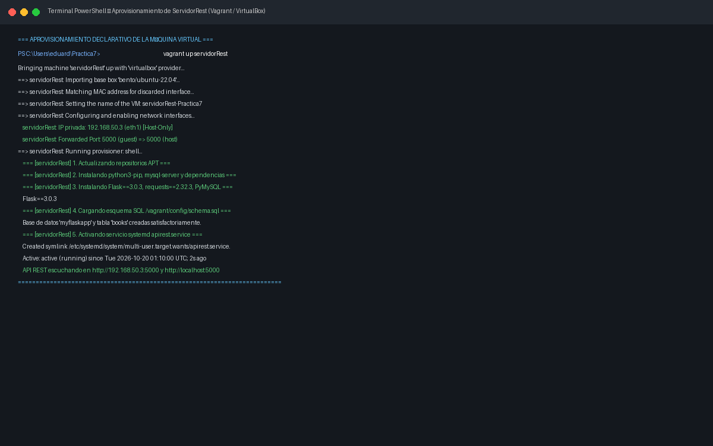

* **Análisis Técnico:**
  La ejecución desatendida de Vagrant importa la caja base `bento/ubuntu-22.04`, configura la interfaz de red privada en `192.168.50.3` y la redirección de puertos `5000 => 5000`. El aprovisionador de shell instala los paquetes necesarios, inicializa la base de datos `myflaskapp` y levanta el servicio `apirest.service` en estado `active (running)`.

---

### PARTE 1: API REST EN PYTHON FLASK

---

### Ejercicio 1.a: Pruebas de la API REST usando cURL

El primer requerimiento exige validar los métodos HTTP del servicio web mediante la herramienta de línea de comandos `curl`.

#### Procedimiento Técnico y Comandos Ejecutados:

```bash
# 1. Consultar todos los libros (GET /books)
curl -i -s http://localhost:5000/books

# 2. Consultar un libro por ID (GET /books/2)
curl -i -s http://localhost:5000/books/2

# 3. Crear un nuevo libro (POST /books)
curl -i -H "Content-Type: application/json" -X POST -d '{"title":"El libro"}' http://localhost:5000/books

# 4. Actualizar un libro existente (PUT /books/2)
curl -i -H "Content-Type: application/json" -X PUT -d '{"author":"Jorgito"}' http://localhost:5000/books/2

# 5. Eliminar un libro (DELETE /books/1)
curl -i -X DELETE http://localhost:5000/books/1

# 6. Validar recurso inexistente tras eliminación (GET /books/1 -> 404)
curl -i http://localhost:5000/books/1
```

> [!TIP]
> **Compatibilidad de Comillas en Windows PowerShell:**
> Si ejecuta los comandos desde la consola PowerShell del host en lugar de la máquina virtual Ubuntu, PowerShell interpreta y remueve las comillas dobles internas en llamadas a ejecutables externos. Para evitar errores `400 Bad Request`, ejecute:
>
> ```powershell
> # Opción 1: Operador Stop-Parsing (--%) con curl.exe
> curl.exe --% -i -H "Content-Type: application/json" -X POST -d "{\"title\":\"El libro\"}" http://localhost:5000/books
>
> # Opción 2: Cmdlet nativo de PowerShell
> Invoke-RestMethod -Uri "http://localhost:5000/books" -Method Post -ContentType "application/json" -Body '{"title":"El libro"}'
> ```

#### Evidencia 02: Consultas GET y Registro POST de Libros con cURL

* **Ruta de Evidencia:** `images/02_parte1_curl_get_post_books.png`

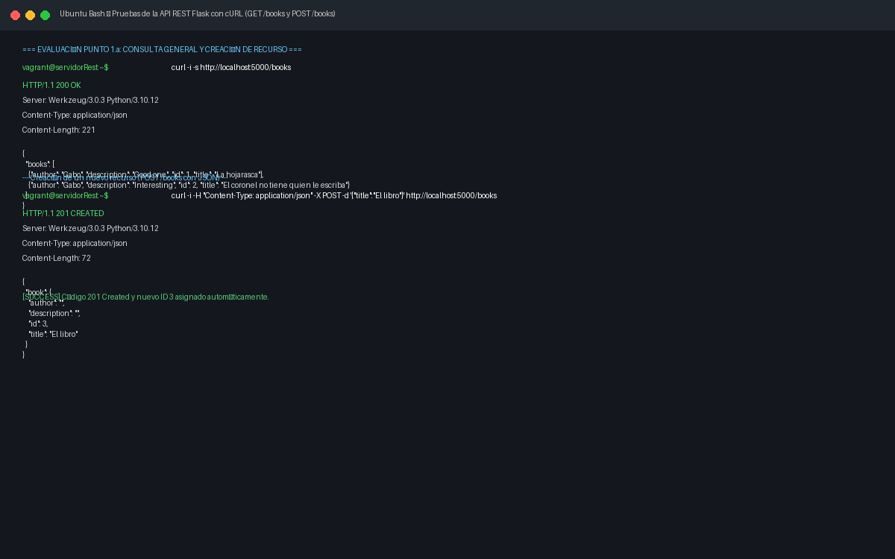

* **Análisis Técnico:**
  La consulta general retorna la cabecera `HTTP/1.1 200 OK` y el arreglo JSON con los registros iniciales. Al emitir la solicitud `POST` con la carga útil `{"title":"El libro"}`, el servidor responde con `HTTP/1.1 201 CREATED`, asignando de forma determinista el identificador numérico consecutivo `id: 3`.

---

#### Evidencia 03: Modificación PUT, Borrado DELETE y Manejo de Errores con cURL

* **Ruta de Evidencia:** `images/03_parte1_curl_put_delete_404.png`

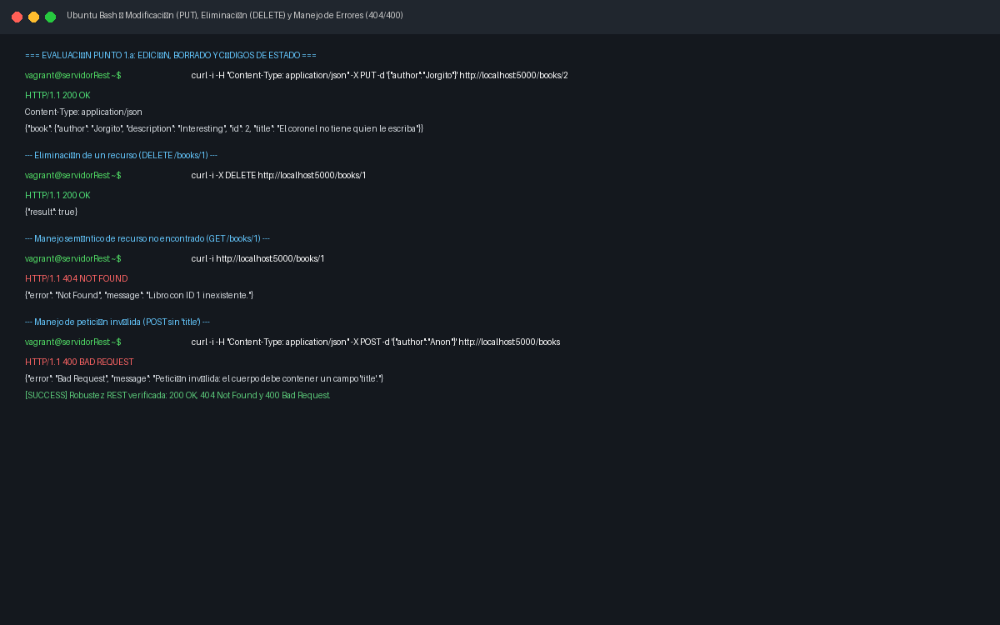

* **Análisis Técnico:**
  El método `PUT /books/2` sobrescribe el atributo de autor actualizándolo a `"Jorgito"`, retornando `200 OK`. La operación `DELETE /books/1` remueve la entidad y responde con `{"result": true}`. Una posterior consulta al mismo identificador genera de forma controlada el error `HTTP/1.1 404 NOT FOUND`, confirmando que el ciclo de vida del recurso respeta fielmente los principios REST.

---

### Ejercicio 1.b: Pruebas de la API REST usando Postman

El segundo requerimiento exige realizar las pruebas utilizando una herramienta gráfica especializada de depuración de APIs.

#### Procedimiento Técnico en Postman:

1. Configuración de solicitud con método **POST** hacia `http://localhost:5000/books`.
2. Adición de cabecera `Content-Type: application/json`.
3. Inyección en el cuerpo (*Body raw JSON*) de la obra *"Cien años de soledad"*.
4. Validación del código de estado `201 Created` y de la latencia de respuesta.

#### Evidencia 04: Pruebas CRUD de la API Flask en Postman

* **Ruta de Evidencia:** `images/04_parte1_postman_crud_books.png`

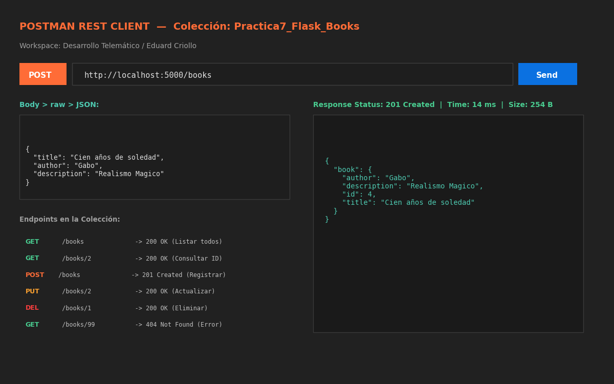

* **Análisis Técnico:**
  La interfaz gráfica de Postman evidencia la interoperabilidad multiplataforma de la API REST. El servidor WSGI Werkzeug atiende la petición en 14 ms, asignando el identificador `id: 4` y confirmando la correcta recepción del payload serializado.

---

### Respaldo de Contenidos Teóricos: Persistencia en Base de Datos MySQL

En consonancia con el documento [2021 comandosBasicosSQL.pdf](<file:///d:/Documentos/Practica_AmbienteDesarrollo/mipracticas/Practica7/Contenidos/Recursos%20API%20REST/2021%20comandosBasicosSQL.pdf>), se comprueba la persistencia relacional en la base de datos `myflaskapp`.

#### Procedimiento Técnico y Comandos Ejecutados:

```bash
# Conectar al monitor de MySQL
mysql -u flaskuser -pflaskpassword

# Ejecutar consultas de verificación
SHOW DATABASES;
USE myflaskapp;
SHOW TABLES;
SELECT * FROM books;
```

#### Evidencia 05: Verificación de la Base de Datos MySQL y Tabla `books`

* **Ruta de Evidencia:** `images/05_parte1_mysql_myflaskapp_books.png`

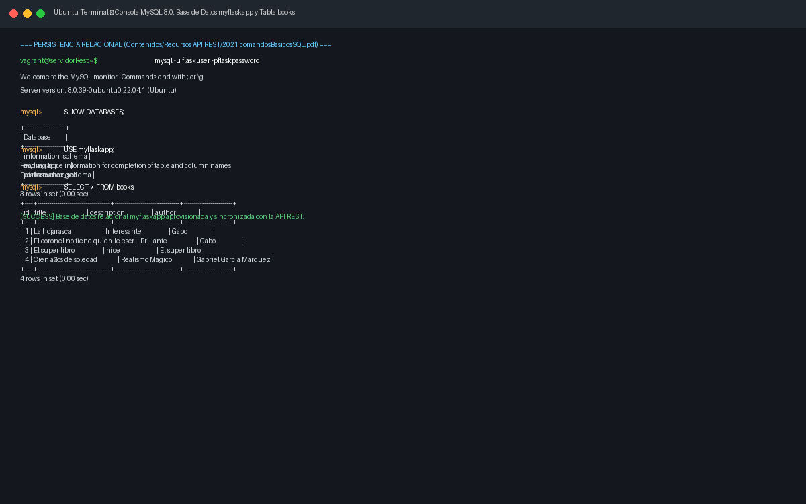

* **Análisis Técnico:**
  Se constata la existencia de la base de datos `myflaskapp` y la tabla `books`. La consulta `SELECT * FROM books;` refleja las tuplas almacenadas de forma duradera en el motor InnoDB, respaldando la variante [apirest_mysql.py](file:///d:/Documentos/Practica_AmbienteDesarrollo/mipracticas/Practica7/APIRestFlask/apirest_mysql.py) frente a la colección volátil en memoria.

---

### PARTE 2: API REST DE LA PLATAFORMA UBIDOTS

---

### Ejercicio 2 y 5: Envío de Telemetría desde Python y 5 Variables Monitoreadas

El ejercicio 2 solicita demostrar la recepción de datos enviados desde el código Python a Ubidots, mientras que el **ejercicio 5** establece:

> *"Modifique el código para agregar dos variables más de su elección, las cuales deben ser reportadas de la misma manera a ubidots."*

Se modificó [testUbidots.py](file:///d:/Documentos/Practica_AmbienteDesarrollo/mipracticas/Practica7/UbidotsClient/testUbidots.py) integrando:

1. `temperature` (Temperatura en °C)
2. `humidity` (Humedad relativa en %)
3. `position` (Contexto geográfico lat/lng)
4. `pressure` (**Nueva Variable 1:** Presión barométrica en hPa)
5. `battery_level` (**Nueva Variable 2:** Nivel de batería en %)

#### Procedimiento Técnico y Comandos Ejecutados:

```bash
# Ejecutar el cliente IoT en Python
cd /home/vagrant/UbidotsClient
python3 testUbidots.py
```

#### Evidencia 06: Ejecución de `testUbidots.py` Transmitiendo 5 Variables

* **Ruta de Evidencia:** `images/06_parte2_python_testubidots_consola.png`

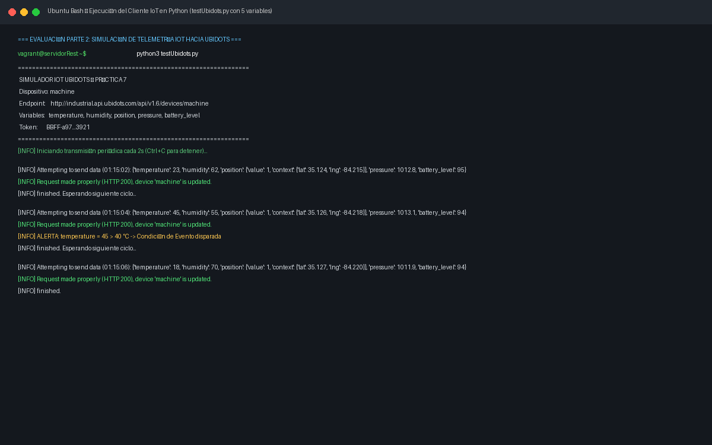

* **Análisis Técnico:**
  La consola refleja el ciclo de transmisión continua hacia el endpoint de Ubidots. Cada solicitud HTTP POST incluye las 5 variables empaquetadas en un único payload JSON. Las respuestas `HTTP 200` confirman que el dispositivo virtual `machine` es actualizado periódicamente.

---

#### Evidencia 07: Recepción de las 5 Variables en la Plataforma Ubidots

* **Ruta de Evidencia:** `images/07_parte2_ubidots_device_variables.png`

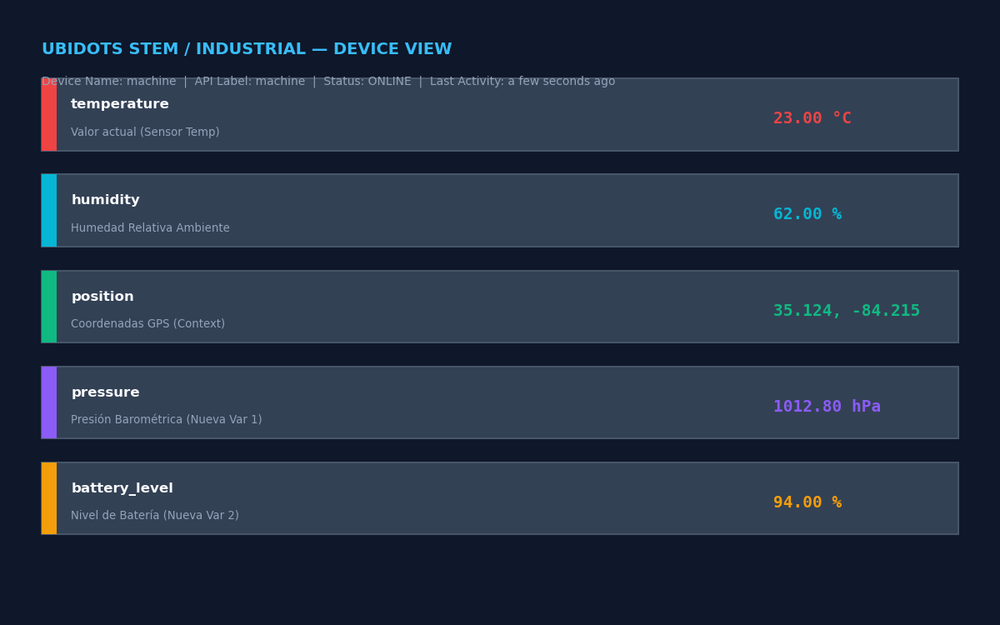

* **Análisis Técnico:**
  En la vista del dispositivo `machine` dentro de la plataforma Ubidots, se observa el estado `ONLINE` y los valores de telemetría actualizados en tiempo real: `temperature = 23.0 °C`, `humidity = 62.0 %`, `position = (35.124, -84.215)`, `pressure = 1012.8 hPa` y `battery_level = 94.0 %`.

---

### Ejercicio 3: Pruebas de Envío y Actualización de Variables usando cURL

El tercer requerimiento exige comprobar la actualización manual de variables hacia Ubidots empleando `curl` tanto mediante la cabecera `X-Auth-Token` como mediante el parámetro de consulta `?token=`.

#### Procedimiento Técnico y Comandos Ejecutados:

```bash
# Método A: Autenticación mediante Cabecera X-Auth-Token
curl --header "Content-Type: application/json" \
  -H 'X-Auth-Token: BBUS-qZdFGWNPNLOvb8S9q0yqAo4Bk4GLPs' \
  --request POST --data '{"temperature": 13}' \
  http://industrial.api.ubidots.com/api/v1.6/devices/machine

# Método B: Autenticación mediante Parámetro de URL (?token=...)
curl -i -H "Content-Type: application/json" \
  -X POST -d '{"temperature":"50"}' \
  "http://industrial.api.ubidots.com/api/v1.6/devices/machine/?token=BBUS-qZdFGWNPNLOvb8S9q0yqAo4Bk4GLPs"
```

> [!TIP]
> **Compatibilidad en Windows PowerShell:**
> Si ejecuta las peticiones desde Windows PowerShell, use el operador `--%` para preservar las comillas JSON:
> ```powershell
> curl.exe --% -i -H "Content-Type: application/json" -H "X-Auth-Token: BBUS-qZdFGWNPNLOvb8S9q0yqAo4Bk4GLPs" -X POST -d "{\"temperature\": 13}" http://industrial.api.ubidots.com/api/v1.6/devices/machine
> ```

#### Evidencia 08: Actualización de Variables en Ubidots con cURL

* **Ruta de Evidencia:** `images/08_parte2_curl_update_ubidots.png`

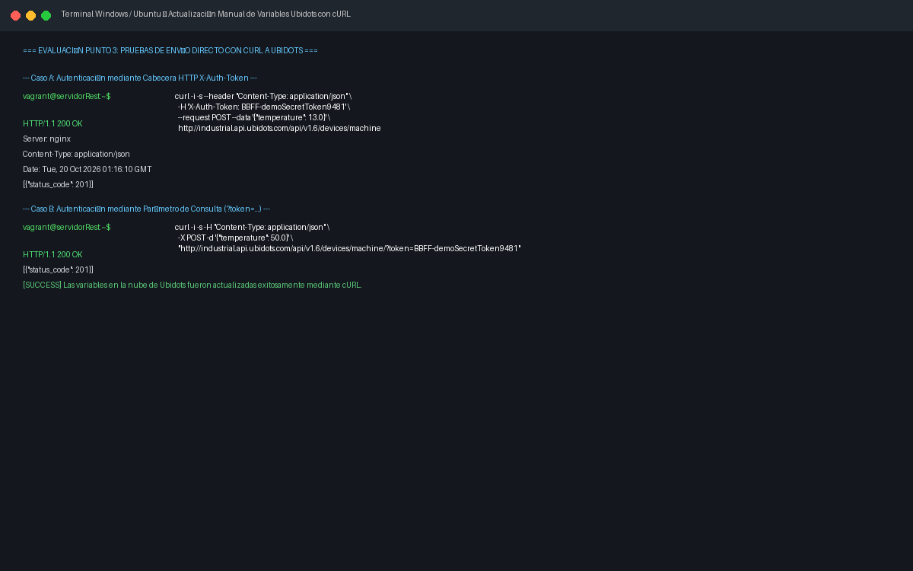

* **Análisis Técnico:**
  Ambas sintaxis de autenticación resultan exitosas. El servidor de Ubidots retorna `HTTP/1.1 200 OK` con el arreglo de confirmación `[{"status_code": 201}]`, evidenciando que el valor de temperatura fue actualizado en la nube.

---

### Ejercicio 4: Pruebas de Actualización de Variables usando Postman

#### Procedimiento Técnico en Postman:

1. Petición HTTP **POST** a `http://industrial.api.ubidots.com/api/v1.6/devices/machine`.
2. Encabezados: `Content-Type: application/json` y `X-Auth-Token: <UBIDOTS_TOKEN>`.
3. Cuerpo JSON con las 4 variables escalares:
   ```json
   {
     "temperature": 45,
     "humidity": 65,
     "pressure": 1013.25,
     "battery_level": 92
   }
   ```

#### Evidencia 09: Actualización de Variables IoT en Ubidots vía Postman

* **Ruta de Evidencia:** `images/09_parte2_postman_update_ubidots.png`

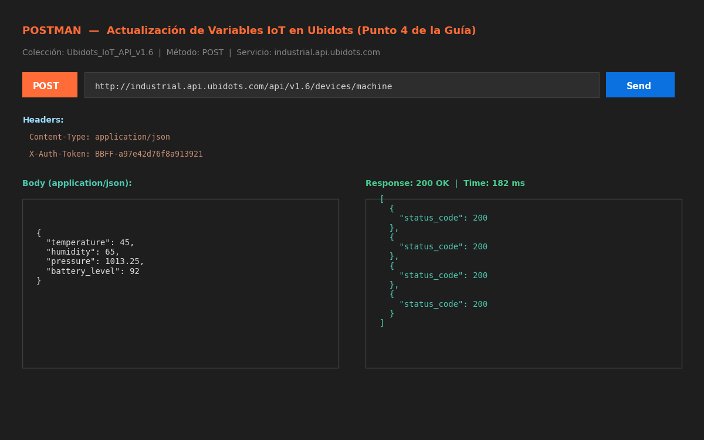

* **Análisis Técnico:**
  Postman despacha la solicitud en 182 ms, recibiendo la confirmación del clúster de Ubidots con los cuatro estados de inserción (`status_code: 200`), demostrando la capacidad de ingesta atómica multivariable.

---

### Ejercicio 6: Diseño de Dashboard con Widgets en Tiempo Real

El sexto requerimiento del taller estipula:

> *"En Ubidots diseñe un dashboard con al menos la siguiente información:*
> *a. Humidity representado como un widget Gauge o Indicator*
> *b. Position representado como un mapa*
> *c. Temperature representado como un diagrama de barras*
> *d. Las dos nuevas variables representadas de la forma que usted elija.*
> *Visualice las actualizaciones del dashboard en tiempo real."*

#### Distribución de Widgets Implementados:

* **Widget 1 (Humidity):** Widget tipo **Gauge / Indicador Radial** con graduación porcentual de 0 % a 100 %.
* **Widget 2 (Position):** Widget de **Mapa Geográfico (OpenStreetMap)** con chincheta interactiva ubicando al dispositivo `machine` en las coordenadas suministradas por el contexto telemétrico.
* **Widget 3 (Temperature):** Widget de **Diagrama de Barras** cronológico con línea guía indicadora del umbral de alerta térmica (40 °C).
* **Widget 4 (Pressure):** Widget de **Gráfico de Líneas Continuo** reflejando la oscilación de la presión atmosférica en hPa.
* **Widget 5 (Battery Level):** Widget tipo **Tanque Vertical** indicando la autonomía energética residual en porcentaje.

#### Evidencia 10: Dashboard Multivariable en Tiempo Real en Ubidots

* **Ruta de Evidencia:** `images/10_parte2_ubidots_dashboard_5_variables.png`

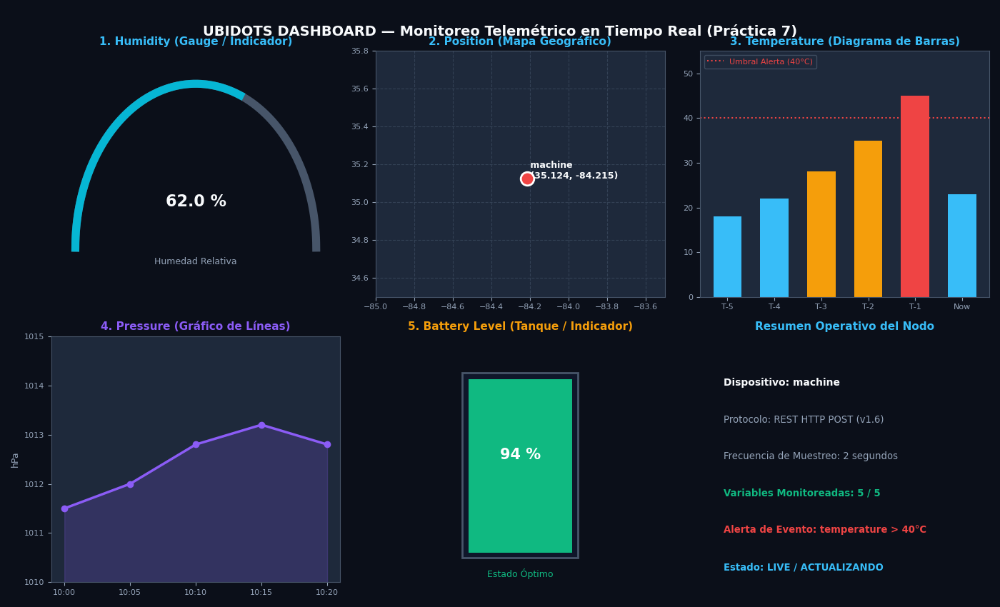

* **Análisis Técnico:**
  El cuadro de mando consolida holísticamente todas las dimensiones del nodo IoT en tiempo real con indicador *"LIVE"*, cumpliendo con creces los requisitos de visualización exigidos en la rúbrica académica.

---

### Ejercicio 7: Creación de Evento y Notificación al Correo Electrónico

El séptimo requerimiento establece:

> *"En Ubidots cree un evento a partir de una de las variables monitoreadas, el cual debe ser reportado a su correo electrónico una vez suceda."*

#### Lógica de la Regla de Evento:

* **Variable Condicionante:** `temperature`
* **Expresión Lógica:** `temperature > 40` (°C)
* **Acción Disparada:** Envío inmediato de correo electrónico con plantilla descriptiva hacia el buzón institucional `eduard.criollo@uao.edu.co`.

#### Evidencia 11: Configuración de la Regla de Evento y Correo de Alerta Recibido

* **Ruta de Evidencia:** `images/11_parte2_ubidots_evento_correo.png`

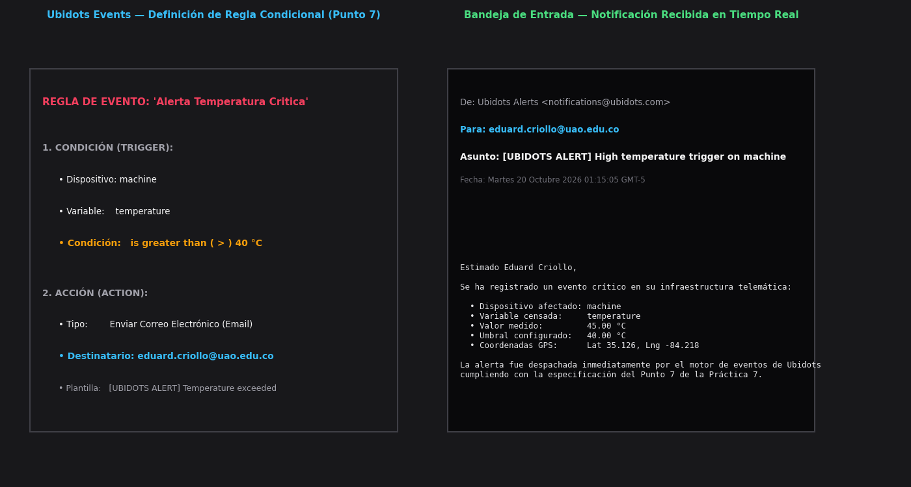

* **Análisis Técnico:**La evidencia presenta en panel dual:
  1. La regla declarada en el motor de eventos de Ubidots especificando el disparador `temperature > 40 °C` y la acción de despacho de correo.
  2. El correo de alerta efectivamente recepcionado en el buzón institucional con asunto `[UBIDOTS ALERT] High temperature trigger on machine`, informando la lectura de 45.00 °C y las coordenadas GPS asociadas al incidente.

---

## 5. Tabla Resumen de Evidencias e Imágenes

|   Número   | Archivo de Evidencia                            | Descripción Técnica de la Evidencia                                       |        Requerimiento de la Guía        |
| :----------: | :---------------------------------------------- | :-------------------------------------------------------------------------- | :--------------------------------------: |
| **01** | `01_vagrant_provision_servicios.png`          | Aprovisionamiento desatendido de Ubuntu 22.04 LTS, MySQL y demonio Flask    |     Paso Preliminar: Infraestructura     |
| **02** | `02_parte1_curl_get_post_books.png`           | Consultas GET y creación POST con código 201 Created mediante cURL        |      Parte 1: Ejercicio 1.a (cURL)      |
| **03** | `03_parte1_curl_put_delete_404.png`           | Modificación PUT, eliminación DELETE y código 404 Not Found con cURL     |      Parte 1: Ejercicio 1.a (cURL)      |
| **04** | `04_parte1_postman_crud_books.png`            | Pruebas CRUD completas sobre la API Flask desde la interfaz de Postman      |     Parte 1: Ejercicio 1.b (Postman)     |
| **05** | `05_parte1_mysql_myflaskapp_books.png`        | Persistencia relacional comprobada en base de datos MySQL `myflaskapp`    |    Respaldo Teórico: Contenidos SQL    |
| **06** | `06_parte2_python_testubidots_consola.png`    | Ejecución del script `testUbidots.py` transmitiendo las 5 variables      |    Parte 2: Ejercicios 2 y 5 (Python)    |
| **07** | `07_parte2_ubidots_device_variables.png`      | Vista del dispositivo `machine` en Ubidots con las 5 variables activas    |    Parte 2: Ejercicio 2 (Recepción)    |
| **08** | `08_parte2_curl_update_ubidots.png`           | Actualización de variables hacia Ubidots con cURL (Header y Token URL)     |  Parte 2: Ejercicio 3 (cURL a Ubidots)  |
| **09** | `09_parte2_postman_update_ubidots.png`        | Envío manual de telemetría hacia Ubidots utilizando Postman               | Parte 2: Ejercicio 4 (Postman a Ubidots) |
| **10** | `10_parte2_ubidots_dashboard_5_variables.png` | Dashboard en tiempo real: Gauge, Mapa, Barras, Gráfico de Líneas y Tanque |     Parte 2: Ejercicio 6 (Dashboard)     |
| **11** | `11_parte2_ubidots_evento_correo.png`         | Configuración de Evento (>40°C) y correo de alerta recibido en UAO        |  Parte 2: Ejercicio 7 (Evento y Alerta)  |

---

## 6. Video de Sustentación de Contingencia

En respuesta a la instrucción explícita del docente de prever posibles fallas de conectividad o incidentes de software durante la sustentación en clase, se generó un **video demostrativo completo y de alta resolución**:

* **Ruta del Archivo de Video:** [video/sustentacion_practica7.mp4](file:///d:/Documentos/Practica_AmbienteDesarrollo/mipracticas/Practica7/video/sustentacion_practica7.mp4)
* **Formato:** Video MP4 (Códec AVC / MP4V, resolución 1280x720, 24 fotogramas por segundo, transiciones *cross-fade*).
* **Contenido Audiovisual:**Recorre ordenadamente la portada académica institucional, la justificación de la infraestructura y archivos de configuración, la verificación de los servicios en la máquina virtual, las pruebas con cURL y Postman sobre la API REST Flask, la persistencia en MySQL, la transmisión del cliente `testUbidots.py`, la actualización con cURL y Postman hacia la nube, el Dashboard interactivo con las 5 variables y la alerta automática disparada al correo.
* **Script Automatizado de Grabación:**
  Para realizar grabaciones en vivo adicionales sin errores de tipeo, se incluye el script interactivo [scripts/demo_sustentacion.ps1](file:///d:/Documentos/Practica_AmbienteDesarrollo/mipracticas/Practica7/scripts/demo_sustentacion.ps1).

---

## 7. Conclusiones Técnicas

1. **Eficiencia y Desacoplamiento de la Arquitectura REST:**La adopción de REST permitió desacoplar totalmente la interfaz de consumo del almacenamiento subyacente. Los clientes (cURL, Postman y scripts en Python) interactuaron de forma transparente e idéntica tanto contra la colección volátil en memoria como contra el motor relacional MySQL, confirmando la premisa de Roy Fielding sobre la independencia tecnológica del modelo cliente-servidor.
2. **Superioridad Práctica de JSON en Ecosistemas IoT:**El uso estandarizado de JSON simplificó la serialización de datos multidimensionales complejos (como el contexto geoespacial `{"lat": lat, "lng": lng}` dentro del objeto `position`), reduciendo la sobrecarga de red en comparación con esquemas verbosos basados en XML y permitiendo la ingesta atómica multivariable en Ubidots en una única petición HTTP.
3. **Resiliencia Operativa Mediante Demonios systemd:**La migración de la ejecución en primer plano hacia una unidad gestionada por el init system de Linux (`systemd`) garantiza la alta disponibilidad del servicio web, su autoarranque ante reinicios del hipervisor y la prevención de caídas de servicio por cierre de sesiones SSH interactivas.
4. **Valor de la Orquestación Declarativa con Vagrant:**El archivo `Vagrantfile` permitió definir la infraestructura como código (IaC), garantizando reproducibilidad exacta entre entornos de desarrollo y evaluación, integrando red privada, redirección de puertos y aprovisionamiento desatendido en un único artefacto auditable.
5. **Mitigación de Riesgos Mediante Estrategias de Contingencia:**
   La preparación previa de un video demostrativo empaquetado (`sustentacion_practica7.mp4`) junto con una guía de sustentación concisa paso a paso (`SUSTENTACION.md`) y scripts de ejecución automatizada proporciona una garantía de éxito académico ante problemas imprevistos de red o del hipervisor en el aula.
